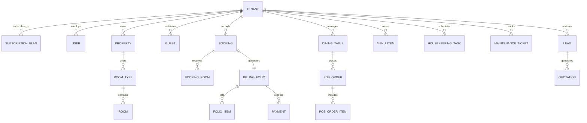

# GrandStay Hospitality Management SaaS CRM 🏨

A production-grade, multi-tenant SaaS application engineered for **resorts, hotels, boutique villas, restaurants, and hospitality groups**. GrandStay streamlines the complete hospitality lifecycle: room tape chart matrices, front desk reservations, guest folios, restaurant dining POS with KOT generation, housekeeping & maintenance dispatch, banquets & event leads with automated PDF quotation generation, role-based access control (RBAC), and multi-tenant SaaS subscription billing.

---

## 🌟 Key Highlights & Architectural Features

- **Multi-Tenant SaaS Architecture:** Tenant isolation, configurable subscription tiers (Trial, Starter, Professional, Enterprise), plan capacity limits (max rooms, max properties, max staff), and Super Admin impersonation.
- **Interactive Visual Room Tape Chart:** 14-day timeline grid displaying color-coded reservation blocks with real-time status indicators (Reserved, Checked-In, Checked-Out, Housekeeping, Maintenance).
- **Front Desk Operations:** Seamless booking creation with dynamic tariff calculation, multi-room group reservations, early check-in, late check-out, identity card verification, and automatic folio provisioning.
- **Restaurant POS & F&B Management:** Floor plan table management, digital menu with category filtering, instant KOT (Kitchen Order Ticket) generation, split billing, and **1-Click Folio Room Charge Transfer** (charge dining bills directly to guest room balance).
- **Billing Folios & Automated PDF Invoices:** Complete running folio items ledger, multi-mode payment recordings (UPI, Cash, Card, NetBanking), GST/tax calculations, and pixel-perfect PDF invoice rendering with ReportLab.
- **WhatsApp Guest Communications:** Automated WhatsApp vouchers with check-in details, booking references, and balance reminders formatted for instant 1-click dispatch.
- **Housekeeping & Engineering Maintenance:** Real-time room turnover statuses (Dirty, Cleaning, Inspected, Available), maintenance ticket prioritization (Urgent, High, Normal), and technician work order tracking.
- **Banquets & Event CRM:** Lead pipeline for weddings and corporate conferences, dynamic quotation builder with deposit milestones, and downloadable branded PDF proposals.
- **SaaS Owner Master Super Admin Portal:** High-level metrics across all customer resorts, recurring revenue tracking, tenant provisioning, plan upgrades, and zero-password tenant impersonation for customer support.

---

## 🛠️ Technology Stack

| Layer | Technologies |
| :--- | :--- |
| **Backend API** | Python 3.11, FastAPI, SQLAlchemy 2.0 (ORM), Pydantic v2 |
| **Database** | MySQL 8.0 (InnoDB, `utf8mb4_unicode_ci`), PyMySQL + Cryptography |
| **Authentication & Security** | Argon2id password hashing, PyJWT (JSON Web Tokens), OAuth2 Bearer, RBAC |
| **Document Generation** | ReportLab (Vector PDF Invoices & Quotations), OpenPyXL (Excel Reports) |
| **Frontend SPA** | React 18, Vite, TypeScript, Tailwind CSS, Lucide React Icons |
| **State & Data Fetching** | TanStack Query (React Query v5), Axios with automatic token refresh |
| **Data Visualization** | Recharts (Revenue Area Charts, Occupancy Trends, Department Breakdowns) |
| **DevOps & Containers** | Docker, Docker Compose, Nginx, Windows Batch Automation |

---

## 🚀 Quick Start (Local Deployment)

### Method 1: One-Click Windows Launcher (Recommended)
Simply double-click the included batch launcher at the project root:
```bat
Start-Hospitality-CRM.bat
```
This script validates dependencies, starts the FastAPI backend server on `http://127.0.0.1:8000`, starts the Vite frontend server on `http://localhost:5173`, and opens your default browser automatically.

---

### Method 2: Manual Terminal Setup

#### 1. Database Setup (MySQL 8.0)
Make sure MySQL service is running on `localhost:3306`.
```sql
CREATE DATABASE hospitality_crm CHARACTER SET utf8mb4 COLLATE utf8mb4_unicode_ci;
```

#### 2. Backend Setup
```bash
cd backend
python -m venv venv
venv\Scripts\activate      # On Windows (or source venv/bin/activate on Linux/macOS)
pip install -r requirements.txt

# Run database seeder (Creates tables and demo data)
python seed.py

# Launch FastAPI development server
uvicorn app.main:app --host 127.0.0.1 --port 8000 --reload
```
API Documentation and interactive Swagger UI will be available at:
👉 **`http://127.0.0.1:8000/docs`**

#### 3. Frontend Setup
```bash
cd frontend
npm install
npm run dev
```
Open your browser to:
👉 **`http://localhost:5173`**

---

### Method 3: Docker Compose
```bash
docker-compose up --build -d
```
- Frontend: `http://localhost:5173`
- Backend API: `http://localhost:8000`
- MySQL: `localhost:3306`

---

## 🔑 Demo Login Credentials

The database seeder pre-populates the system with complete demonstration data:

| Role / Entity | Email | Password | Access Level |
| :--- | :--- | :--- | :--- |
| **SaaS Master Super Admin** | `superadmin@grandstay.com` | `Admin@12345` | Global SaaS management, tenant provisioning, revenue analytics, tenant impersonation |
| **Resort General Admin** | `admin@serenevalley.com` | `Admin@12345` | Full resort management (Serene Valley Resort & Spa) |
| **Front Desk Receptionist** | `vikram@serenevalley.com` | `Admin@12345` | Tape chart, reservations, check-in/out, folios, guest profiles |
| **Restaurant POS Cashier** | `ananya@serenevalley.com` | `Admin@12345` | Dining tables, menu billing, KOTs, room folio charge transfers |
| **Housekeeping Supervisor** | `rahul@serenevalley.com` | `Admin@12345` | Cleaning assignments, room turnover inspections, maintenance |

---

## 🏛️ System Architecture & Data Model



---

## 🧪 Testing & Verification

Automated backend test suites verify authentication, tenant boundaries, booking lifecycle, folio item settlement, and PDF generation:
```bash
cd backend
venv\Scripts\pytest -v tests/test_api.py
```

Frontend compilation and type checks:
```bash
cd frontend
npm run build
```

---

## 📄 License
Proprietary SaaS Software. All rights reserved. Designed and developed for **GrandStay Hospitality Management CRM**.
